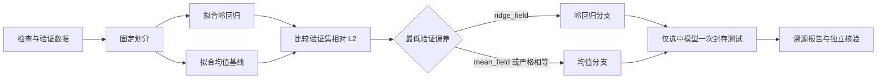

# 科研交互、分支与恢复（v0.5）

2026-10-15。P1 和 P2 在原有结构化规划 Agent 上实现：先通过终端对话形成并确认规格，再生成计划；Darcy 可比较两个候选方法，按验证集误差选择一个进入封存测试。运行故障仅在明确无状态变化、且属于允许的临时错误时有界重试。

## PowerShell 使用

在 `CityU_Hackathon_AI4S/RUT_Science` 目录启动：

```powershell
& '.\.venv\Scripts\python.exe' -m rut_science chat --model deepseek-flash --recover
```

如需脚本入口，以下命令只为本次 PowerShell 子进程指定执行策略：

```powershell
powershell -NoProfile -ExecutionPolicy RemoteSigned -File .\scripts\Run-ResearchAgent.ps1 -Recover
```

示例输入：

```text
research> 使用 Darcy 数据做科研实验。
（Agent 追问预测目标）
research> 预测压力场，比较岭回归和均值基线，按验证集误差择优，alpha=1，seed=2026，最多训练2次，测试次数1。
（展示完整草案、每项来源、默认值、执行策略及哈希）
research> /confirm
（确认后生成并校验计划，执行本地训练、选择、一次测试与报告）
research> /exit
```

全部模型请求默认读取项目级 `../API_key_Agent.json`。对话与规划使用同一份凭据和同一个持久预算账本，默认最多 12 次请求、120,000 token 准入；未知用量保持预留。`--max-seconds` 为子科研执行的累计活动时间上限，不计算等待用户输入的时间。当前没有配置货币费用。

## 对话与确认契约

模型输出字段提案和待澄清问题，宿主负责类型、目录、语义证据、参数边界与冲突校验。数据集和目标必须能对应到用户原文；其他字段分别标为 `user`、`model_suggestion`、`system_default` 或 `method_contract`。数据身份、单位、测试封存策略由本地工具契约固定。

| 命令 | 行为 |
|---|---|
| `/spec`、`/status` | 展示当前草案；不运行科研工具 |
| `/confirm`、`确认执行` | 绑定最后展示的当前草案、规格和完整执行策略，保存确认凭据后执行 |
| `/confirm <完整草案哈希>` | 显式绑定当前哈希；旧哈希会被拒绝 |
| `/resume`、`/run` | 继续当前已确认运行；已完成的运行仅核验，不重复工具 |
| `/exit` | 保留会话并退出 |

每次新需求输入先撤销当前执行授权，再提取新草案。确认记录、旧草案和旧实验保留。重复确认同一未修改草案不会创建第二次实验。已经完成的实验不能通过修改原规格重写；新草案重新确认后创建新子目录。未完成的旧实验继续保留，但对话入口只恢复当前确认对应的实验。

`--prepare-only` 可以只整理与确认规格；该模式的 `/run` 和 `/resume` 也不会启动工具。没有完整草案、存在冲突、提取失败或未确认时，均不能创建科研执行。

支持的数据目录目前限于三份合成材料工作流 fixture 和已准备的本地 Darcy 数据。`--data` 指向另一份满足相同 Darcy 数据契约的 bundle，不是任意文件上传或通用科研代码生成。`--backend offline` 为有限双语规则控制器；API 模式才使用语言模型提取需求。语言模型的澄清语义仍可能出错，需通过后续配对评测量化。

## 两个候选与数据分支

`ResearchSpec.model=validation_select` 明确授权两次拟合：`ridge_field` 和 `mean_field` 各一次，使用相同的 128 个训练样本和 32 个验证样本。两者都只使用训练集拟合标准化。32 个封存测试样本来自独立原始测试源。



`planspec_v2` 共八个角色节点，增加 `select_model` 工具。两个拟合节点都必须完成；测试节点必须引用选择节点返回的 `model_id`，不能直接绑定某个候选。选择依据是验证集相对 L2，严格相等时优先均值。LangGraph 记录 `branch_ridge` 或 `branch_mean` 分支及依据；测试值不反馈给规划器用于再次选模型。

这是两个固定候选的可验证方法选择，不代表通用科研搜索、条件跳过任意步骤或学得的规划策略。原六步单模型协议继续可用。

## 有界执行恢复

`--recover` 显式启用恢复；默认最多全程两次、每节点一次。仅允许 `transient_unavailable`、`timeout_before_start`，并且记录的状态前后完全相等、剩余时间和工具预算均充足。校验失败、规格不匹配、数值错误、权限或非法动作、状态改变，以及进程中断后副作用不确定的节点，均不自动重试。

每次恢复保留原失败调用，记录 `recovery_decision`，将计划版本加一并绑定父计划哈希；已成功节点内容和产物保留，只重试同一失败节点和参数。不自动改模型、alpha、数据划分或研究目标，不重复成功的训练与封存测试。

可控故障验证命令：

```powershell
& '.\.venv\Scripts\python.exe' -m rut_science plan run `
  --workflow darcy --validation-select --recover `
  --fault-tool train_model --fault-count 1 `
  --output outputs/plan_selection_fault_new
```

`--fault-tool/--fault-count` 是显式的调用前故障 fixture，轨迹标记 `fault_injected=true`；不是真实服务宕机。标准对话入口默认不注入故障。API 请求超时不属于科研工具恢复，当前不自动重发模型请求。

恢复后分开报告：

| 字段 | 解释 |
|---|---|
| `strict_execution_success` | 原严格评分；只要存在工具错误，仍保留失败 |
| `recovery_success` | 科学验收、失败原子性、错误类型、预算、同参重试、版本及证据检查全部通过 |
| `score_protocol=scientific_recovery_v1` | 项目恢复扩展；其中 `execution_success` 指该扩展协议的结果 |
| `strict_score` | 完整原评分，禁止抹去失败后混入原始严格 SR |

恢复样本不能与旧 RUT 严格 SR 直接合并。独立科学检查重算两个候选的验证误差、选中模型的测试预测和指标，并与独立 SciPy 参考比较；报告同时包含候选、选择依据和数据来源。

## 暂停、进程恢复与审计

```powershell
# 示例脚本中的确认来自 scripted_operator，属于工程演示，不冒充真实用户研究。
powershell -NoProfile -ExecutionPolicy RemoteSigned -File .\scripts\Run-ResearchAgent.ps1 `
  -Backend offline -InputFile examples/research_synthetic_zh.json `
  -RunDirectory outputs/chat_pause_new -StopAfter 3

# 新进程恢复；已有会话使用保存的策略，不用命令行新参数更换原协议。
powershell -NoProfile -ExecutionPolicy RemoteSigned -File .\scripts\Run-ResearchAgent.ps1 `
  -Resume -RunDirectory outputs/chat_pause_new
# 进入后输入 /resume

& '.\.venv\Scripts\python.exe' -m scripts.verify_research_chat outputs/chat_pause_new
```

恢复要求代码、工具契约、数据与 LangGraph 版本一致。会话和子执行各有进程锁；中断时已有 `running` 标记的科研节点拒绝自动重放。冻结源码供历史审计使用；升级代码后应新建会话。

对话目录保存 `conversation.json`、`drafts/`、`confirmations/`、`checkpoint.json`、`model_calls.json`、共享 `budget.json` 和冻结源码。`execution_001/` 等子目录包含计划版本、完整状态轨迹、评分、科研报告和场预测。以上私有审计材料不作为模型输入。

`verify_research_chat` 不调用模型，核对操作者轮次、确认前草案展示、字段原文来源、确认凭据、子执行状态/计划/科学验收和共享请求账本。源码/产物哈希用于检测意外更改，不是抵抗可任意改写整个工作区的攻击者的签名系统。

## 验证记录与后续

新增自动测试覆盖需求缺失、歧义与矛盾、提案越权、来源区分、旧哈希拒绝、修改撤销授权、重复确认、准备模式、预算共享、暂停恢复，以及候选绑定、两条数据分支、失败重试与拒绝边界。正式运行和测试结果见 [本次交付验收](P1_P2_Delivery_2026-10-15_zh.md)。

下一步是固定这些契约后扩展多轮配对任务与故障集合，比较普通工具循环和结构化规划的严格成功率、恢复成功率、交互成功率与成本。当前尚未进行足以支持策略优劣或泛化结论的对照实验，也未实现 RL、OpenCode/MCP 或通用任意代码执行。
