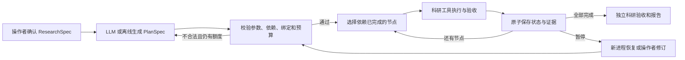

# v0.4：PowerShell 中运行的结构化科研规划 Agent

本次在已验证的科研后端上实现了真实 `PlanSpec`、计划校验、节点就绪检查、执行状态、计划版本和跨进程恢复。API 模式由模型生成完整计划，宿主校验后再执行；`offline` 是不消耗模型额度的规则计划控制器。原 `api_dag` 提示基线保持原含义。

**2026-10-14 交付状态：80 项自动测试通过，真实 API 规划及 PowerShell 跨进程修订/恢复均已实际跑通。** 最终证据见本页第 8 节。

## 1. 直接启动

当前机器已配置项目 `.venv`。在 PowerShell 中：

```powershell
Set-Location 'D:\Python Files\CityU_Project\CityU_Hackathon_AI4S\LangGraph_RL_Agent\RUT_Science'

# 真实模型生成计划，默认使用已有 Darcy 数据与已确认研究规格。
# 凭据和端点统一来自项目级 API_key_Agent.json。
& '.\.venv\Scripts\python.exe' -m rut_science plan run --backend api --model deepseek-flash

# 离线计划控制器，同样实际执行 Darcy 科研计算。
& '.\.venv\Scripts\python.exe' -m rut_science plan run --backend offline

# 无 Darcy 数据时，先运行已有合成科研任务。
& '.\.venv\Scripts\python.exe' -m rut_science plan run --workflow synthetic
```

不传 `--output` 时自动创建唯一运行目录，并在终端打印目录位置和节点进度。显式目录必须新建或为空，防止覆盖旧运行。API 模式会调用用户配置的模型服务；默认最多 3 次计划请求、80,000 token 准入及 180 秒累计活动运行时间。

也可以使用 PowerShell 启动脚本：

```powershell
powershell -NoProfile -ExecutionPolicy RemoteSigned -File '.\scripts\Run-PlanningAgent.ps1' -Backend api -Model deepseek-flash
```

当前机器直接执行 `.ps1` 会被默认执行策略拒绝。上述选项只作用于启动的 PowerShell 进程，不改变全局执行策略；直接 Python 命令同样可用。

若换到新环境，需要 Python 3.12；本次实际验证环境为 Windows x64、Python 3.12.14：

```powershell
python -m venv .venv
& '.\.venv\Scripts\python.exe' -m pip install -r requirements-planning.lock.txt
# 或安装项目的可选依赖：pip install -e '.[darcy,planning]'
# 若本地尚无 Darcy bundle：
& '.\.venv\Scripts\python.exe' -m rut_science darcy prepare
```

## 2. 实际架构



LangGraph `StateGraph` 编排 propose / validate / execute / verify 四个阶段；执行阶段根据已校验的任务 DAG 选择就绪节点。[官方 Graph API](https://docs.langchain.com/oss/python/langgraph/graph-api) 提供图与节点接口。

跨进程持久化由本项目原子 JSON 业务 checkpoint 实现，每次工具调用前后保存。恢复时重建 LangGraph 图并从保存阶段继续。该机制使用应用层 checkpoint；LangGraph 图本身没有挂接数据库 checkpointer。运行目录有 OS 进程锁，避免两个终端同时执行同一会话。

## 3. PlanSpec 的含义

示例节点：

```json
{
  "node_id": "train",
  "tool": "train_model",
  "arguments": {
    "split_id": "$split.split_id",
    "model": "ridge_field"
  },
  "depends_on": ["split"],
  "outputs": ["model_id"],
  "acceptance": {"status": "ok"}
}
```

- `$split.split_id` 是前序节点工具返回的真实 ID；不允许模型预先猜测 ID。
- 划分的 dataset_id 可以引用查看或核查节点的同一已观测数据身份，例如 `$inspect.dataset_id` 或 `$validate.dataset_id`；科研依赖和规格检查都必须满足。
- `depends_on` 决定节点就绪条件，存储顺序可以不同，执行必须满足科研前置依赖。
- `outputs` 是导出字段名的字符串数组，不是字段映射。
- `acceptance` 是宿主支持的可执行条件，不能由模型写任意 Python 表达式。核查还要求 `valid=true`，封存评测要求 `sealed=true`，报告要求 `evidence_complete=true`。
- 完整计划绑定 `research_spec_hash`、版本、父计划哈希和累计工具调用预算。

校验器拒绝循环、遗漏必要阶段、缺失依赖、错误模型/参数、未知输出引用、直接 ID、非法工具、预算超限和弱化验收条件。一个计划只有校验通过后才可能调用科研工具。

当前环境仍要求固定六个科研阶段：inspect → validate → split → train → evaluate → report。因此首版计划可以验证、修订和恢复，但还没有足够丰富的任务分支来证明规划算法增益。

## 4. 暂停、恢复、查看状态

```powershell
# 完成四个节点（包含训练）后在安全边界暂停。
& '.\.venv\Scripts\python.exe' -m rut_science plan run --output outputs/my_plan_run --stop-after 4

# 另一个 PowerShell 进程/终端中查看和恢复。
& '.\.venv\Scripts\python.exe' -m rut_science plan status --output outputs/my_plan_run
& '.\.venv\Scripts\python.exe' -m rut_science plan resume --output outputs/my_plan_run
& '.\.venv\Scripts\python.exe' -m rut_science plan verify --output outputs/my_plan_run
```

恢复会检查代码、LangGraph 版本、规格、数据与工具契约，累计预算不会清零，已完成节点不会重新执行。API 计划已经接受后，恢复执行不需要重新请求模型。

`--stop-after` 是本次调用中完成的节点数。进程在工具调用中途硬退出时，保存的 running 标记表示效果不确定，系统拒绝自动重放；当前恢复保证针对完成节点边界。科研执行与检查点不是外部远程作业事务，尚无通用 exactly-once 承诺。

## 5. 修改未执行的计划

先暂停运行，将 `plans/plan_v001.json` 复制到新的文件，修改未执行节点，并设置：

- `version` 加 1；
- `parent_plan_hash` 使用原计划内容哈希，可从原 `plans/validation_v001.json` 查看；
- 保留 `plan_id`、`research_spec_hash`；
- 已执行节点及其输入、依赖、输出、验收条件保持相同。

```powershell
& '.\.venv\Scripts\python.exe' -m rut_science plan revise --output outputs/my_plan_run --plan-file revised_plan.json --reason '调整未执行报告节点'
& '.\.venv\Scripts\python.exe' -m rut_science plan resume --output outputs/my_plan_run
```

旧版本、修订理由、被替换的待执行节点和原始错误均保留。改变已确认研究目标或已经产生效果的失败节点需要新的明确协议，当前不会自动让模型重写规格或抹掉失败。模型自动修复仅用于**执行前的非法计划提案**；执行失败后的修订由操作者明确提交。

`--backend file --plan-file <path>` 可执行操作者提供的完整计划；`plan validate --plan-file <path>` 可只校验而不执行。

外部计划与研究规格支持普通 UTF-8 及 Windows PowerShell `Set-Content -Encoding UTF8` 常见的 UTF-8 BOM 文件。

## 6. 产物与核验

```text
outputs/<run>/
  manifest.json               # 模型、预算、数据/规格/工具与源码哈希
  research_spec.json
  proposals/attempt_*.json     # 原始计划提案，包含被拒绝版本
  plans/plan_v*.json           # 已接受计划与历史版本
  plans/validation_v*.json
  checkpoint.json             # 哈希绑定的完整宿主状态；包含私有科研证据
  status.json                 # 可读的阶段、节点与用量摘要
  budget.json                 # API 请求/token 账本；离线模式没有模型请求
  episode.json                # 完成后的运行与科学评分
  trajectory.jsonl
  planning_history.json
  model_calls.json
  scientific_reports.json
  report.md                   # 可读结果与相关产物链接
  reference.json
  test_predictions.npz        # Darcy 场预测和真实数值
  verification.json
  source_snapshot/
```

checkpoint 和参考数组由宿主持有；规划器请求仅包含公开规格、工具契约和计划校验反馈，未提供 Gold、测试数组、模型权重或任意 shell 工具。当前不是对任意代码执行的 OS 沙箱。

最终验收重算科学指标，并核对计划版本链、节点就绪条件、参数绑定、状态链、工具调用次数、模型请求哈希和保存产物。已完成运行再次恢复会先核验产物，拒绝悄悄接受改写结果。

## 7. 研究边界与下一步

v0.4 首版交付是可运行的结构化规划机制，不是新的 RL 算法。LangGraph 学习 Demo 保留独立用途，主科研 Agent 已有自己的规划入口。v0.5 已加入有限数据目录内的自然语言到 ResearchSpec 提取和终端确认、双候选验证集分支与有界原子故障恢复，见 [P1/P2 使用说明](Research_Interaction_and_Recovery_zh.md)。复杂科研搜索、运行中原位变更目标、OpenCode/MCP 和留出泛化实验仍待完成。

接下来应扩展有多个合法路径与可恢复故障的任务，明确新的恢复评分，再在固定模型、工具和预算下比较普通工具循环与结构化规划 Agent。

## 8. 本次实际验证与结果

| 验证项 | 实际结果 |
|---|---|
| 自动测试 | 80 项通过；包含原科研/配置测试和新增计划、拒绝路径、暂停恢复、修订、进程锁、BOM、结果发布恢复等测试 |
| 依赖 | `pip check` 通过，依赖版本保存在 `requirements-planning.lock.txt` |
| API 完整规划 | DeepSeek Flash 1 次请求生成计划，首次提案通过；6 次科研工具调用成功 |
| 有效 API 用量 | 1,217 输入 token、419 输出 token；未知用量预留为 0 |
| PowerShell 恢复 | 离线计划执行 4 个节点后暂停，改用新进程，保留训练结果 |
| 计划修订 | 使用 PowerShell 写入的带 BOM JSON 将未执行报告节点改名，保存 v2 和父计划哈希 |
| 修订后执行 | 仅执行封存测试与报告，整个运行训练/测试/报告各一次，总工具调用仍为 6 |
| 科研结果 | 两份正式运行的独立测试平均相对 L2 均为 0.1250051181，独立 SciPy 参考与状态/产物验证通过 |

正式交付实例：

- [API 生成的完整计划](../outputs/plan_darcy_api_final_v040_2026-10-14/plans/plan_v001.json)
- [API 运行可读报告](../outputs/plan_darcy_api_final_v040_2026-10-14/report.md)
- [API 运行验证](../outputs/plan_darcy_api_final_v040_2026-10-14/verification.json)
- [API 用量账本](../outputs/plan_darcy_api_final_v040_2026-10-14/budget.json)
- [PowerShell 修订后的 v2 计划](../outputs/plan_darcy_resume_final_v040_2026-10-14/plans/plan_v002.json)
- [修订与恢复报告](../outputs/plan_darcy_resume_final_v040_2026-10-14/report.md)
- [修订原因与版本历史](../outputs/plan_darcy_resume_final_v040_2026-10-14/planning_history.json)
- [修订与恢复验证](../outputs/plan_darcy_resume_final_v040_2026-10-14/verification.json)

开发过程保留两个被拒绝的 API 运行，各 3 次计划请求，均没有调用科研工具：`plan_darcy_api_v040_2026-10-14` 中 `outputs` 被生成为对象，提示与反馈随后明确为字符串数组；`plan_darcy_api_verified_v040_2026-10-14` 暴露旧校验器对合法核查输出引用过窄，随后增加等价绑定与测试。这些记录没有覆盖，也不按后来的规则改写旧评分。另有修复前代码上的成功开发检查保留；正式证据使用以上 `*_final_*` 目录和对应源码快照。

这些是固定六步任务的工程验证，不是统计性策略对照。没有依据单次成功或请求减少宣称规划优于普通工具循环。

完整核查脚本为 `python -m scripts.verify_planning_delivery`，不调用模型；检查结果写入 `outputs/planning_delivery_verification_v040.json`。
