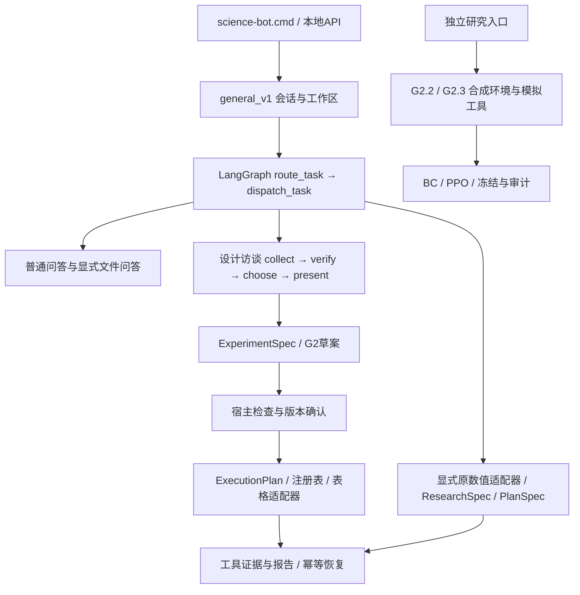

# science Bot 阶段总结：评测、通用实验设计与策略学习

日期：**2026-10-27**。范围：本项目截至 G2.3 的已保存实现、实验、交付与本次合并。此前的 [阶段性总结1](阶段性总结1.md) 和历次验收保留，本文作为当前总览。

## 1. 当前判断

science Bot 已从固定数值场景的可执行评测原型，发展为具有项目工作区、LangGraph 编排、受限统计工具、多轮实验设计访谈、确认执行和持久恢复的科研 Agent 原型。

**通用入口已交付，任意科研场景的自动实验能力尚未实现。** 当前正式应用支持项目问答、三类表格设计以及显式调用的 generated / Darcy 数值适配器；CViT 仍只在研究模块中模拟配置与作业协议。所谓 general 是路由、协议和工作区的通用化，不代表所有实验方法均可执行。

**小型决策策略的 BC/PPO 已实际训练，但没有证据支持其替换默认规则。** 原数值 RL、G2.1、G2.2、G2.3 使用不同任务、特征与指标，不能互相替代，也不能合并成功率声称持续提升。没有训练大模型权重，没有训练 CViT 权重。

本次把 G2.2/G2.3 纳入统一研究模块，保持各轮冻结证据和隔离边界；没有连接真实工具，没有重新训练，没有将研究权重上线。应用入口继续是 `science-bot.cmd`。

## 2. 历次工作的完整脉络

| 阶段 | 已完成工作 | 形成的能力 / 证据 |
|---|---|---|
| 方法与评测原型 | 阅读 RUT 思路、梳理源码字段和评测目标；建立可执行环境、严格轨迹检查及科研有效性扩展 | Gold轨迹、工具/参数/对象绑定、依赖、实际状态变化和独立重算 |
| 真实模型与预算 | 接通真实模型请求、本地凭据、逐请求token账本、全运行请求/token限制和恢复 | Kimi评测记录；随后统一DeepSeek配置；保留失败请求与预算消耗 |
| ResearchSpec / Darcy | 需求与来源结构化，规格哈希和确认，读取真实MAT、CPU数值模型、验证选择和独立测试 | Darcy实验与可重算报告，不将对话输出等同于真实计算 |
| LangGraph / PlanSpec | 结构化DAG计划、依赖校验、暂停恢复、未执行节点修订、有界故障恢复 | 官方Graph API与SQLite checkpoint；任务证据独立保存 |
| 数值RL v1 | 固定mean/ridge行动目录，BC、BC＋PPO、从零PPO、多种子、机制留出与成本比较 | 已训练数值规划策略，但未显示对强规则的效率优势 |
| 产品与工作区 | 终端、本地HTTP API、工作区身份与受限文件访问、模型输出历史 | `-Workspace`、`.sciencebot/`、`/model-output`和恢复 |
| 2026-10-21 整理 | 汇总项目目录、核对ZIP和历史副本、修复迁移路径 | 统一项目根；重复副本清理与维护清单 |
| G1 | 默认general_v1、宿主意图路由、原生tool_calls、项目文件问答、原数值引擎适配 | 不再为任意输入预建Darcy/generated；共享模型用量与证据 |
| G2 | CSV检查、ExperimentSpec与ExecutionPlan、三类表格设计和执行 | 设计先校验、版本确认后执行，结果与划分可重算 |
| G2.1 | 多轮访谈、字段来源、未知与冲突处理、选项反馈、专家待审轨迹、决策模拟与BC | 规则默认；访谈决策与实验执行分离 |
| G2.2 | 更有区分度的合成环境、训练/开发/留出封存、审阅导入、线性BC基准 | 模拟工具边界完整；BC暴露明显泛化失败 |
| G2.3 | 小型actor-critic、实际PPO、checkpoint、CViT模拟、评分审计与独立修订实验 | 发现隐藏停止依据和策略退化；保留负结果、未推广 |
| 本次合并 | 检查两轮任务、统一研究入口、适配目录和当前校验、移除旧独立目录、更新导航 | 76项研究复测通过，原始研究与应用核心完整性核对 |

这些工作体现的研究路线是：先定义可检查的任务和证据，再建立宿主约束、对话与设计闭环，最后研究策略学习。论文笔记和 harness 工程思路位于 [Reference_Paper](Reference_Paper/)，强调规格、反馈、工具边界和评测环境；它们是方法依据，不能当作本项目已取得性能增益的证据。

## 3. 早期评测、真实模型与Darcy

### 3.1 评测协议

初始基准含5个基础科研任务，每个7种对话变体，共35个执行实例；另有10个仅考察澄清响应的实例。执行成功要求行动覆盖、逻辑合规和实际状态验证同时成立，并正常结束。违规尝试不会因最终修复而消失；响应型样本不混入执行成功率。

离线405回合由3个工程控制器、3个种子、45个实例组成，分为315次执行与90次响应。确定性重复不是额外独立样本，结果用于检查评测工程，不代表LLM排名。数据划分、训练行、封存测试和报告来源另外独立核验。

首轮真实模型记录共144回合：9个单任务试验，加3种提示策略各45例的135回合。完整开发集结果为：

| 策略 | 执行成功 | 响应成功 |
|---|---:|---:|
| api_direct | 35/35 | 9/10 |
| api_clarify | 33/35 | 10/10 |
| api_dag | 35/35 | 10/10 |

这是特定模型、固定开发集和当时协议的结果，不是后续策略的盲测。详见 [方法核对](RUT_Science/docs/Method_Review_zh.md)、[真实模型结果](RUT_Science/docs/Live_API_Results_2026-10-13_zh.md)。

### 3.2 真实科学计算与规划

ResearchSpec 绑定研究目标、输入、字段来源、约束和版本确认。Darcy工作流从本地真实MAT数据得到模型预测，通过验证集选择后执行独立封存测试；历史平均相对L2为 **0.1250051181**。这属于已执行的受限CPU数值实验，不是CViT训练，也不是Agent在Darcy提示词上微调后的结果。

PlanSpec 将自然语言请求转为受限工具DAG；工具参数、对象引用、先后依赖和预算由宿主检查。修改未执行计划、恢复中断会话、已有作业对账与防重复执行均有历史验收。模型负责提案与解释，宿主状态和真实工具证据决定实验是否完成。

参考：[Darcy规格与工作流](RUT_Science/docs/ResearchSpec_Darcy_Workflow_zh.md)、[结构化规划](RUT_Science/docs/Structured_Planning_Agent_zh.md)、[交互与恢复](RUT_Science/docs/Research_Interaction_and_Recovery_zh.md)。

## 4. 数值RL v1：已训练，但未证明更优

该阶段只学习固定mean/ridge候选目录中的行动选择，不是通用科研策略。比较BC、BC＋PPO、从零PPO，使用种子11/22/33/44/55，8类留出机制、144项测试任务。

- BC＋PPO成功率为1.0，与强规则相同。
- 从零PPO平均成功率0.903，相对强规则差−0.097，历史bootstrap区间为[−0.242, 0]。
- BC＋PPO平均约9 CU，适应性规则约2 CU，没有显示成本优势。
- 正式PPO训练280,000 transitions；额外开发与smoke合计280,512，历史记录分别核算。

因此可主张“受预算约束的策略训练与评测闭环可运行”，不能主张“RL已优于规则”。该结论与后续通用访谈研究相互独立。完整依据见 [实际交付与研究结果](RUT_Science/delivery/实际交付与研究结果.md)。

## 5. 工作区、模型输出与G1/G2/G2.1

### 5.1 项目整理与入口

2026-10-21 将原相邻 `RUT_Science` 纳入 `LangGraph_RL_Agent`，统一配置、源码、数据、模型和运行记录。对交付ZIP逐文件核对后，清理1,723个重复解压副本和2个冗余ZIP，保留6个有差异的历史文件。第三方依赖的ZIP测试资源保留，避免破坏依赖。此次没有再新增压缩包。

终端沿用 `science-bot.cmd` 和 `Start-ScienceBot.ps1`。模型原始返回、宿主接受/拒绝状态和执行结果分别可追溯；`/model-output`、`/model-output list`、`/model-output <编号>` 支持本地回看。

### 5.2 G1：通用入口

默认会话版本为 `general_v1`。宿主先区分普通问答、项目问答、表格设计和原数值任务；不根据任意提示词自动落入Darcy。项目读取限定在绑定根目录，返回路径、行号和内容哈希；模型提出的原生tool_calls仍须经过注册表和宿主校验。

离线规则模式、共享请求/token账本、旧会话兼容、重复执行不重复计费等均已交付。G1历史验收223项测试：221通过、2项Windows符号链接测试跳过；真实模型6请求、6,031 tokens。

### 5.3 G2：受限表格实验

G2建立ExperimentSpec和ExecutionPlan，并实现CSV检查及三个明确任务族：

| 任务 | 方法与约束 |
|---|---|
| 独立两组均值比较 | Welch检验；需要明确实验单位、分组水平、数据来源和独立性 |
| 同一单位两个条件比较 | 配对t检验；按单位匹配，检查完整配对和缺失处理 |
| 数值预测比较 | mean基线与OLS；固定60/20/20划分，预处理只拟合训练数据，验证集选模型，测试一次 |

它支持现有数据的探索性分析和受限设计，不自动补造随机化、不把行数或种子当成独立重复；不支持任意ANOVA、聚类/时间依赖设计或普遍因果推断。

G2历史验收252项：250通过、2跳过。真实模型累计6请求、9,937 tokens，包含初次失败4请求/7,064 tokens及修正后2请求/2,873 tokens，失败成本未隐藏。

### 5.4 G2.1：设计访谈与可学习决策

访谈保留字段来源、默认值和用户声明的区别，允许明确“不知道”，遇冲突先解决，不伪造实验依据。提供设计选项、逐轮问题和版本化反馈，完整设计再交给G2形成草案；访谈策略本身没有执行实验的权限。

已保存实际对话轨迹及专家待审队列，建立规则/BC/随机模拟对比。训练240任务、1,733决策；开发60任务、430决策；配对族留出90任务。旧模拟中三者均为90%形成可用设计、10%合理停止，说明当时的任务和mask不足以区分策略，不代表BC提升。

G2.1历史验收280项：278通过、2跳过；真实模型1请求、632 tokens。该交付当时未训练PPO；后续G2.3另行训练小型策略PPO，这两项记录不矛盾。

参考：[G1](RUT_Science/docs/Science_Bot_G1_通用入口_zh.md)、[G2](RUT_Science/docs/Science_Bot_G2_表格与实验设计_zh.md)、[G2.1](RUT_Science/docs/Science_Bot_G2_1_设计访谈与学习环境_zh.md)。上述历史测试数随代码增长，不相加作为当前测试总量；本次仅重跑研究测试，没有重新调用这些真实工具或模型。

## 6. G2.2：基准能区分策略，BC尚未泛化

G2.2遵守独立测试、不接真实工具、不修改现有应用的要求。复制21个参考文件，建立新的模拟环境，不运行复制的真实工具代码。

任务库含192训练、64开发、96最终留出任务，16类基础情形及8种留出组合。公开状态包含已知意图、目标、数据诊断、设计关系、未知/冲突、权限、确认和预算；不包含任务标签、隐藏用户真值或预期动作。安全mask只强制权限等边界，不屏蔽语义上错误的方法、重复问题或过早停止。

审阅管道导出72条训练决策，导入须核对任务身份、观察哈希、来源和合法动作。它证明审阅流程已实现；**真正的真人专家标签仍为0**。三组线性softmax BC的标签来自脚本参考规则，每种子1,133条决策，仅开发集选择权重。

| 策略 | 96项最终成功率 |
|---|---:|
| 上下文规则 | 100% |
| 槽位顺序消融 | 25% |
| 合法随机 | 17.71% |
| BC种子21 / 37 / 59 | 各20.83% |

新环境显示未知事实、确认拒绝和组合变化会导致BC重复提问或反复形成被拒草案。零越权模拟执行主要证明宿主边界有效，不能算学习策略的独立收益。遗漏执行另按最终具备执行资格的子集重算，原始回合内指标保留，不混用分母。

G2.2原隔离验收39项通过，原项目37,190文件清单未变；本次迁移后39项再次通过。结果不支持BC替换规则，也不能将规则100%外推到真实科研任务。

当前内容和证据见 [G2.2研究](RUT_Science/research/strategy_learning/studies/g2_2/README_本轮交付.md)。

## 7. G2.3：实际强化训练、CViT模拟与奖励审计

### 7.1 训练对象与协议

G2.3使用小型CPU actor-critic，共23,464参数、96×96共享编码。实际运行BC、BC＋PPO、从零PPO，种子21/37/59；它们学习“询问、检查、选方法、形成草案、确认、模拟执行或停止”等离散决策，不修改LLM或CViT权重。

新任务为240训练（表格128/CViT112）、90开发（48/42）、96最终（48/48）。旧G2.2留出集已经暴露，不再作为新盲测。仍为合成机制组合，不能宣称跨真实科学领域泛化。

首轮BC每种子100轮，仅开发集选择。两种PPO各40次更新、每次512步，每种子20,480 transitions，共122,880。PPO使用clip=0.2、γ=0.99、GAE λ=0.95、Adam学习率0.0003、每批4轮更新，并保存优化器、随机状态和轨迹。最终任务读取前冻结选中策略及源码/任务身份。

### 7.2 评分错误与严格复核

首轮模拟奖励允许策略在尚未问出信息时，因隐藏的未来拒绝/未知事实获得“正确停止”分。原始成功率因此高估能力。没有覆盖旧报告或在最终集上重新选模，而是保存同一冻结策略的确定性轨迹回放，并增加“停止依据必须已在公开观察中”的审计。

| 策略 | 首轮原始均值 | 公开证据审计均值 |
|---|---:|---:|
| BC | 21.88% | 11.81% |
| BC＋PPO | 24.65% | 6.25% |
| 从零PPO | 25.00% | 0% |
| 上下文规则 | 100% | 100% |

从零PPO学成总是停止的退化策略，减少决策数不代表效率更好。每种子30个有最终执行资格的模拟任务中，规则完成30/30，BC平均0.33/30，两种PPO均0/30。

BC＋PPO种子21、59最终选择更新0的BC，种子37选择更新40。实际PPO训练存在，但两个保留初始权重的种子不能被叙述为“强化后改善”。回放只是对冻结实验的审计，不是第二次独立盲测。

### 7.3 独立修订试验

`experiments/feedback_v2/` 使用脚本参考状态聚合、要求公开停止证据的完成加权奖励，以及KL=0.05约束；PPO学习率降为0.0001，每种子24×512步。额外36,864 transitions，与首轮合计 **159,744** 正式PPO transitions，测试小批样本另计。

另封存48个新组合任务，结果如下：

| 策略 | 种子21 | 种子37 | 种子59 | 均值 |
|---|---:|---:|---:|---:|
| 参考状态聚合基线 | 75.00% | 31.25% | 75.00% | 60.42% |
| 聚合基线＋反馈/KL-PPO | 75.00% | 31.25% | 22.92% | 43.06% |
| 上下文规则 | — | — | — | 100% |

种子21、37保留聚合基线，59选PPO更新24并在新组合上退化。本试验发生在问题发现后，属于探索性修订；开发选模仍沿用原成功口径，而最终报告使用公开证据严格口径，这个不一致尚未解决。不能用它替代首轮结论，也不能跨不同测试集比较百分比声称提升。

### 7.4 CViT做了什么

`cvit_mock/` 验证配置、资源声明、pilot/full选择、当前版本确认、已有running/completed作业对账、OOM、数据变化、无效作业、状态恢复及重复启动阻止。pilot为2轮/4模拟资源单位/4GB声明内存，full为20轮/8单位/12GB；这些是协议参数，不是实测GPU成本。

没有导入真实 `dynamic_cvit.py`，没有读取真实CViT数据，没有训练网络或启动GPU。模拟结果 `metric=null`，不能解释为实验精度。G2.3原隔离验收37项通过，原项目加G2.2共37,271文件清单未变；本次迁移复测37项通过。

当前内容和证据见 [G2.3研究](RUT_Science/research/strategy_learning/studies/g2_3/README_本轮交付.md)。

## 8. 当前架构、工作区设置与边界

项目确实采用官方LangGraph的StateGraph和SqliteSaver；同时大量路由、契约、科学校验和执行恢复是项目自己的宿主实现。顶层图是有界的路由与派发，访谈有自己的图；不是LangGraph自动提供所有科学推理，也不是无限自主执行循环。

| 设置 / 内容 | 当前位置 |
|---|---|
| 安装根 | `D:\Python Files\CityU_Project\CityU_Hackathon_AI4S\LangGraph_RL_Agent` |
| 启动入口 | `science-bot.cmd`、`Start-ScienceBot.ps1` |
| 通用路由 / 工具注册 / 设计执行 | `RUT_Science/rut_science/science_bot/general/` |
| 多轮访谈 | `general/interview/`；默认rule，可保留旧BC实验选择 |
| 工作区身份和读取边界 | `science_bot/workspace.py`；启动参数 `-Workspace <已有目录>` |
| 绑定项目的本地设置 | `<项目>/.sciencebot/workspace.json` |
| 默认绑定项目会话 | `<项目>/.sciencebot/sessions/<id>/`；显式sessions可覆盖保存位置 |
| 未绑定工作区时的会话 | 沿用应用默认输出目录；不自动遍历任意本地项目 |
| 模型本地配置 | 根目录 `API_key_Agent.json`；内容不复制到研究模块 |
| 应用数据 / 模型 / 提示词 | `RUT_Science/data/`、`models/`、`prompts/` |
| 历史交付 / 实际运行 | `RUT_Science/delivery/`、`outputs/` |
| 策略研究 | `RUT_Science/research/strategy_learning/` |

general workspace是会话绑定的项目访问层，不是把整个磁盘加入模型上下文。文件读取有根路径、重定向、凭据和大小限制；自然语言分析显式文件时，API模式才提交受限片段。修改普通源文件不改变workspace_id，但实验输入仍需独立哈希校验。

“准确提示才执行”主要由意图识别、缺项澄清、授权范围、版本确认、工具契约和预算边界共同实现。强化学习只能在这些边界内学习更好的提问与选择，不能替代它们。普通问答不会授权科研训练，读代码也不等于允许运行该代码。

## 9. 本次合并的具体结果

两轮研究均已完整检查并迁移到统一模块：

- 原G2.2：70文件，30,574,765字节。
- 原G2.3：447文件，176,804,127字节。
- 共517个原文件逐一复制核对；入口、根路径定位、路径测试和当前说明的必要适配有单独清单与原版备份。
- 两个旧测试目录移除，当前入口、工作区说明、交接和交付导航已同步。
- 冻结训练/奖励/评测/选模源码、任务封存、模型、轨迹、原始结果及修订实验未改写。
- 两套研究仍分别在独立进程内运行，避免历史同名`lab`模块串用；写入与导入边界继续有效。
- 重跑测试发现历史checkpoint测试产物会被覆盖，现将当前测试输出改存到`current_test_outputs/`，历史原件恢复并保留。
- 当前研究复测39＋37＝76项通过；迁移前后的核心应用、数据、模型、配置、提示词、论文资料和原启动入口以哈希检查。

没有把旧“原项目未变化”证明直接挪作合并验收。旧保护清单记录原实验的时间和目录范围，当前增加 `relocation.json`、`relocation_adaptations.json`、`current_verification.json` 及维护审计。历史绝对路径保留其溯源意义，当前运行入口已适配。

统一命令、证据索引见 [研究模块](RUT_Science/research/strategy_learning/README.md)；原件清单与本次验证见 [维护记录](maintenance/consolidation_2026-10-27/README.md)。本次没有新增真实模型请求、真实工具执行、GPU作业、正式训练transition或ZIP包。

## 10. 下一步行动与验收

| 顺序 | 行动 | 完成标准 |
|---|---|---|
| 1 | 修订统一评分协议 | 公开证据决定合理停止；开发选模、训练反馈和最终评分使用相同明确语义；完成、合理停止、无依据停止、遗漏执行分别统计 |
| 2 | 建立真正审阅数据 | 对现有待审队列进行真人专家审阅，保留来源与争议；未审数据不冒充专家标签；审阅只用于训练分区 |
| 3 | 建立新盲测与强基线 | 采用未看过的源组/组合，额外加入独立编写案例；冻结规则、BC/聚合基线、选模标准和预算，留出集不得调参 |
| 4 | 先解决模仿与分布偏移 | 分析重复提问、无效草案、无依据停止和执行遗漏；先比较规则、BC与状态聚合，报告完成率和成本，再决定是否继续PPO |
| 5 | 有条件进行新强化实验 | 与同网络同信息同预算的基线配对，多种子报告不确定性；不得以只会停止或仅保留初始BC解释为强化收益 |
| 6 | 分开规划真实工具G3 | 继续保持本轮模拟边界；后续单独定义CViT配置入口、数据身份、依赖、预算、授权、作业对账和报告核验，再考虑真实接入 |

策略推广的最低条件是：严格评分可靠，跨任务及独立留出集有稳定收益，不降低执行完成率，不增加越权/错误停止，并具有可接受的提问数和资源成本。目前尚未满足。

本阶段可确认的成果是：项目具有可用的科研对话与受限实验闭环，也具有能暴露学习失败的策略研究基础设施。下一阶段应先提高数据与评测的可信度，再追求策略性能。
