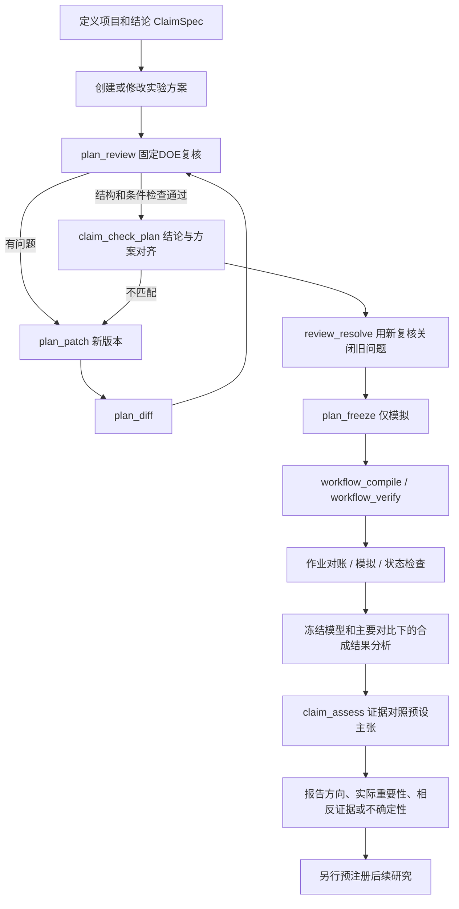

# science Bot 详细科研工具库

日期：2026-10-28。为“修改方案、复核闭环、检查结论与计划是否匹配、规划项目全部步骤”建立的独立交付目录。

共 **45个工具契约**：20个在本目录可运行的离线工具，4个复用现有受限入口/数学能力的条目，15个待实现契约，2个人工流程，4个禁用的真实执行工具。工具有了schema不等于已实现；运行器会拒绝待实现、人工授权和真实执行条目。

目录没有修改或自动注册到当前science Bot聊天入口。现有 `/research`、`/doe` 继续按原实现运行；本工具库通过独立CLI使用。没有真实Darcy/CViT训练、模型API或GPU作业。

## 1. 三个判断必须分开

| 工具 | 回答什么 | 不能推出什么 |
|---|---|---|
| `plan_review` | 这份设计是否满足已支持的结构、DOE数学、来源与预算检查？ | 数据独立性、实际随机化和科学假设已经得到证明 |
| `claim_check_plan` | 主要对比、处理水平、响应、实验单位和研究范围是否匹配目标结论？ | 结论已经得到结果支持 |
| `claim_assess` | 已冻结分析下的证据区间是否条件性支持预设方向/实际重要性？ | 数学证明、等效、因果识别或全领域泛化 |

“计划可以检验某结论”与“结果支持某结论”使用不同工具和不同返回字段。前者没有观测结果时返回 `claim_supported=null`；后者只在具体证据、冻结计划和预设ClaimSpec匹配时运行。本库演示证据全部是合成，因此始终 `real_scientific_claim_verified=false`。

## 2. 工具如何分组

| 层 | 工具 | 本阶段重点 |
|---|---|---|
| 目标与上下文 | `project_create`、`claim_define`、`requirement_intake`、`question_next`、`context_read`、`literature_attach` | 目标转为明确主张；事实来源与未知项分开 |
| 数据与单位 | `dataset_register`、`dataset_inspect`、`dataset_lineage_review`、`unit_structure_review`、`metric_define` | 来源、泄漏、实验单位、技术重复及指标聚合 |
| 方案管理 | `plan_create`、`plan_patch`、`plan_diff`、`artifact_read` | 原版不可变，修改生成新版本和来源，检测并发旧编辑 |
| DOE与复核 | `plan_review`、`design_matrix_build`、`sample_size_compute`、`randomization_generate`、`missingness_review`、`review_resolve` | 固定验收器检查，反馈后修订并重新检查 |
| 结论对齐 | `claim_check_plan`、`causal_identification_review` | 主张与实验可检验范围一致，不做过度外推 |
| 控制与编排 | `plan_freeze`、`workflow_compile`、`workflow_verify`、`human_approval_record` | 版本冻结、工具依赖、每步验收、宿主授权 |
| 环境与成本 | `environment_inspect`、`cost_estimate` | 依赖与资源依据，不把模拟CU当GPU实测 |
| 作业管理 | `job_reconcile_mock`、`job_run_mock`、`job_poll_mock`、`darcy_fit_real`、`cvit_train_real`、`job_cancel_real` | 先对账、幂等启动、状态核对；真实执行禁用 |
| 分析与证据 | `result_analyze`、`result_diagnostics`、`multiplicity_plan`、`sealed_test_evaluate_real` | 按预设模型分析，避免数据与选择泄漏 |
| 结论与闭环 | `claim_assess`、`equivalence_noninferiority_review`、`out_of_distribution_evaluate`、`loop_next_action`、`report_build` | 支持/相反/不确定；后续研究重新规划和预注册 |
| 工具发现 | `tool_catalog` | 查询每个工具的实现状态、schema、权限、失败规则及后续工具 |

每个条目的实际状态见 [详细工具契约](详细工具契约.md)，该文件给出完整输入/输出schema、前置条件、验收、作用范围、幂等、失败规则和下一工具；机器版为 [tool_catalog.json](tool_catalog.json)。

## 3. 可以修改哪些方案内容

`plan_patch`接受显式字段替换，例如：

```json
{
  "plan_ref": "已有方案的完整64位引用",
  "expected_contract_hash": "调用者读取的原合同哈希",
  "changes": [
    {"path": "/analysis/model", "value": "blocked_full_factorial"},
    {"path": "/analysis/target_power", "value": 0.9},
    {"path": "/replicates", "value": 3}
  ],
  "reason": "根据复核加入完整交互与区组，并提高预定功效要求"
}
```

这段引用是格式示意。真实示例中的有效输入和引用见 `runs/cvit/demo_summary.json`。

允许修改问题、因素水平、响应、单位声明、区组、重复、随机化、分析和预算；修改理由成为新需求版本的显式来源。新版本重新编译运行计划，并需要新复核。这里登记的是操作者提出的声明，不会把操作者的话自动认定为真实科学依据。

不能通过patch直接设置“复核通过”“真实授权”“结果成功”、伪造合同哈希或修改执行状态。旧版本保留，`plan_diff`给出变化，旧复核不能冻结新版本。

## 4. 复核闭环的完整顺序



关键门槛：

1. `review_resolve`不能仅凭“已修复”文字关闭问题，必须提供后代方案的新固定复核。
2. `plan_freeze`要求复核和结论对齐属于同一个方案引用，冻结主要对比和ClaimSpec。
3. `workflow_verify`检查环、未知依赖、工具是否实现、参数名和上游输出引用。
4. 模拟作业按冻结方案身份复用；已有作业不能切换benefit/null/harm场景刷结果。
5. 结果分析必须包含冻结的全部实验单位，主要对比不能事后改变。
6. `claim_assess`只接受冻结时绑定的结论，不能看完数据后改方向或实际重要性阈值。
7. 不确定结果不会触发自动重试、加样本直到显著或降低成功标准。

## 5. “能否验证结论”具体怎么检查

以“候选CViT在指定Darcy数据与训练协议下，比baseline的平均相对L2更低”为例，ClaimSpec至少写清：

- 指标：`relative_l2`，聚合到训练运行，而非把场内网格点当独立重复。
- 对比：候选减baseline；架构主效应平均于预设学习率。
- 处理水平：哪两个架构、哪两个学习率，不能只写“A/B”。
- 实验单位：在某个数据实现区组内独立分配随机流的训练运行。
- 方向：越低越好。
- 实际重要性：在结果出现前声明的差异阈值，和统计方向分开。
- 范围：只限声明的数据来源与训练协议；不能自行改写成“所有PDE都更好”。

本库复核会比较这些结构化字段；**自然语言主张与字段是否语义一致仍需操作者核对**，当前没有实现自动理解任意论文结论的Judge。

计划中必须存在能估计主要对比的处理组合、合理的单位与误差结构、预先确定的模型和评价协议。当前数学复用G2.4，只支持两处理完全随机设计、两处理完整区组设计和2×2全因子。复杂因果识别、非劣、等效、复杂重复测量和广泛分布泛化单列契约，不能套用普通差异检验。

DOE从目标、因素与水平选择设计；混杂可能使目标效应无法分开估计，不能仅因计划“步骤齐全”而放行。[NIST设计选择](https://www.itl.nist.gov/div898/handbook/pri/section3/pri3.htm)、[混杂与别名](https://www.itl.nist.gov/div898/handbook/pri/section3/pri3343.htm)

## 6. “已有结果是否支持结论”具体怎么检查

离线 `result_analyze` 在合成单位级观测上拟合冻结的固定效应模型，包含区组及已声明交互，并计算预定主要对比的t置信区间。主效应按±1编码使用2倍系数，交互差中之差使用4倍系数。

`claim_assess`将区间转换为“正值代表有利”的方向：

| 条件 | 返回 |
|---|---|
| 区间完全位于有利方向 | `supports_direction_under_assumptions` |
| 区间完全位于相反方向 | `opposite_direction_under_assumptions` |
| 区间跨零或触及零 | `inconclusive` |
| 有利方向的区间下界还超过实际重要性阈值 | 额外设置 `practical_benefit_supported=true` |

当前规则是预设双侧区间，不声称实施了任意单侧、等效或非劣检验。区间依赖模型假设和抽样机制，不能解释成“这个具体区间有95%概率包含真值”。[NIST区间定义](https://www.itl.nist.gov/div898/handbook/prc/section1/prc14.htm)、[t区间与检验关系](https://www.itl.nist.gov/div898/handbook/eda/section3/eda352.htm)

本库仅分析自己生成的合成单位响应，未做真实模型诊断或专家校准。即使方向得到支持，也始终标记`evidence_scope=synthetic_mock_only`，不产生真实科研结论。

## 7. 项目步骤中的参数、输出与验收

生成的工作流不只是工具名列表，每个节点保存：

```json
{
  "id": "assess_claim",
  "tool": "claim_assess",
  "depends_on": ["analyze"],
  "arguments": {
    "claim_ref": {"$input": "claim_ref"},
    "analysis_ref": {"$from": "analyze.analysis_ref"}
  },
  "produces": ["assessment_ref", "status"],
  "acceptance": "Plan, source, contrast and interval agree",
  "on_failure": "stop_preserve_evidence_then_revise_and_review_new_version"
}
```

此处`produces`为裁剪示意，实际DAG包含工具全部输出。`$from`表示必须从真实上游返回引用，不能由模型捏造；`$input`表示调用工作流时显式提供的输入。当前提供编译和校验，演示器逐步调用工具，尚未实现任意DAG的通用调度器。

项目还应事先安排来源检查、环境/成本、授权、失败保存、统计诊断、科学报告和独立复现等步骤；目录中的待实现条目就是明确的缺口，不会被假成功填充。

## 8. 运行方式

在 `LangGraph_RL_Agent` 根目录：

```powershell
& '.\RUT_Science\.venv\Scripts\python.exe' -B 'Research_Tool_Library/run.py' list
& '.\RUT_Science\.venv\Scripts\python.exe' -B 'Research_Tool_Library/run.py' describe plan_patch
& '.\RUT_Science\.venv\Scripts\python.exe' -B 'Research_Tool_Library/run.py' demo --domain all
& '.\RUT_Science\.venv\Scripts\python.exe' -B 'Research_Tool_Library/run.py' test
```

完整调用输入、输出、先后顺序和证据：

- [Darcy闭环](runs/darcy/demo_summary.json)
- [CViT闭环](runs/cvit/demo_summary.json)

每个演示21次工具调用，故意先给出错误模型，复核发现问题后生成新版本并修正，最后在合成观测上演示证据判断。没有实际Darcy训练或CViT GPU作业。

单独调用工具：把参数JSON放在本目录，再运行：

```powershell
& '.\RUT_Science\.venv\Scripts\python.exe' -B 'Research_Tool_Library/run.py' call plan_review --input inputs/review_example.json --store runs/cvit
```

`inputs/`中的示例由导出演示生成，引用属于相应runs工作区。所有可写路径限定在本目录；`objects/`按内容哈希保存不可变对象，事件日志保留前序哈希。CLI只读取本目录的显式参数文件，不开放任意文件、shell或密钥读取。

当前验收：20项测试通过，Darcy/CViT两份21步调用演示通过；2,034个既有项目文件核对无意外变化，主Agent工具注册表未改动。完整结果见 [verification.json](verification.json)。

## 9. 与已有项目和训练数据的连接

- 主science Bot：现有 `/research` 和 `/doe` 已上线；这份更细的工具库尚未注册进聊天工具目录，避免把未完成契约当作真实能力。
- G2.4：离线适配器在只读子进程中复用其冻结的schema、设计编译和verifier，调用前检查依赖哈希，不修改旧源码。
- 训练数据：可将 `calls.jsonl` 的工具输入输出与方案版本转换为新一版轨迹；训练前仍需定义公开观察、隐藏评测状态、动作mask、标签来源与严格奖励。
- RL：工具库先定义可操作范围和验收。此交付没有训练任何策略，不能把演示成功视为学习策略提升。

后续建议先实现数据血缘、实验单位和统计诊断的独立核验，并完善真实人工审阅；再把这20个离线工具适配为主Agent的受限工具集合。真实执行接口继续单独设计和验收。
